# TARS — An Articulated, Voice-Interactive Interstellar Robot

[中文](README.md) | **English**

A personal DIY robot inspired by TARS from *Interstellar*. Four servos move its mechanism, two displays show expressions and status, and a PC Companion connects it to voice control and cloud conversation services.

**Estimated materials cost: CNY 152.40 per robot, including provisional prices.** This includes board components, the bare PCB, printed parts, servos, displays, battery, audio modules, wiring and assembly screws. Shipping, labor, soldering consumables, packaging, losses, taxes and extra full-pack purchasing costs are excluded. A PC and cloud service charges are outside this materials budget.

[▶ Watch the complete build and demonstration on Bilibili](https://www.bilibili.com/video/BV1uUW36kEMT/)

[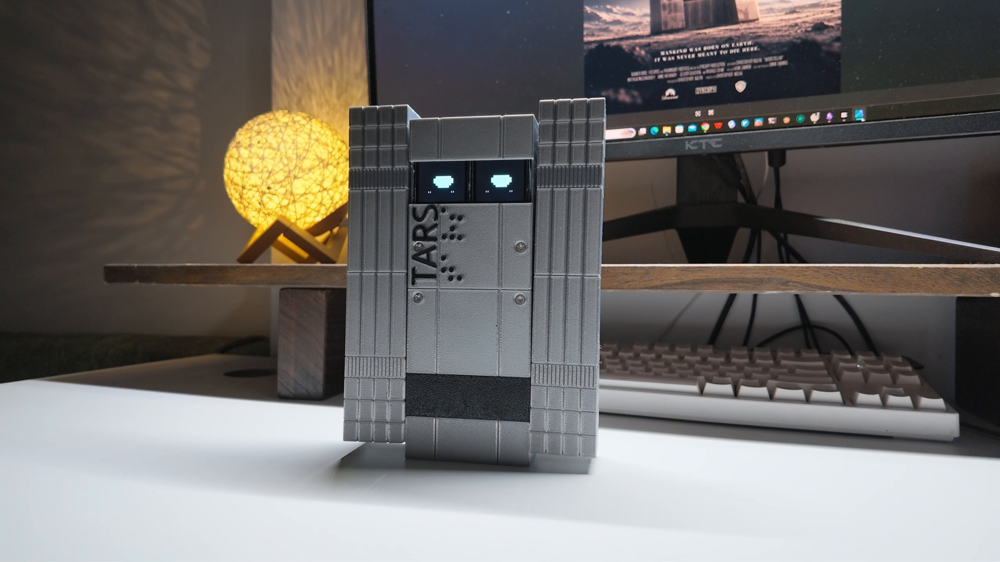](https://www.bilibili.com/video/BV1uUW36kEMT/)

The video is linked on Bilibili; no video file is uploaded to this repository.

## Downloads and project pages

| Resource | Location |
| --- | --- |
| Mechanical models and print projects | [MakerWorld](https://makerworld.com.cn/zh/models/3251650-ke-dong-ke-yu-yin-jiao-hu-de-tarsxing-ji-chuan-yue); the sole host for model files |
| Hardware build page | [OSHWHub](https://oshwhub.com/wenzeng1/project_hgrrprlm) — assembly guide and release attachments |
| PCB source | [TARS_PCB_2026-11-13.epro2](hardware/TARS_PCB_2026-11-13.epro2), EasyEDA Pro / LCEDA Pro |
| Complete BOM and cost workbook | [Excel workbook](hardware/Project_TARS_V1_BOM_2026-11-13.xlsx), with board parts, purchased parts, fasteners and price evidence |
| PC AI configuration | [Companion, API and Doubao voice cloning](docs/AI_SETUP.en.md) |
| Firmware and USB debug packages | Use the final OSHWHub attachments. The author is preparing the final public delivery; historical source is not presented as the final firmware |
| License | [CC BY-NC-SA 4.0](LICENSE.txt) for original materials; commercial use requires separate permission |

## Release status and version boundaries

- Hardware is based on the author's November 13, 2026 project. The author has printed and successfully assembled the current three-plate mechanical project.
- The author confirms that `0.18.2-final65` was flashed on the original robot and its debug page opened. The same firmware supports voice control, conversation and web debugging; voice still requires a running PC Companion.
- Existing repository source includes the historical `0.18.0-director` project. It has not been verified as the exact source of the latest binary. Final standalone firmware and daily-voice delivery will be synchronized when supplied by the author.
- The filming-oriented AI director is not part of the new installation packages. Existing historical code remains development reference, not the reproduction entry point.
- The OSHWHub PCB preview may not yet be generated; the full `.epro2` file and BOM can be downloaded directly.
- Successful operation on the original setup is not a clean-PC reproduction test or validation of arbitrary replacement hardware.

## Capabilities and architecture

| Subsystem | What it does |
| --- | --- |
| Motion | Four MG90S servos; forward movement, turns and preset actions; zero calibration, phase angles and timing |
| Displays | Two ST7735 displays for expressions, status and conversation text |
| Voice | Robot audio input/output with a PC maintaining service connections; command handling depends on the Companion version |
| Debugging | USB connection and local web tools, with separate single-servo and gait debugging entry points |
| Controller | ESP32-S3-WROOM-1-N16R8: 16 MB Flash and 8 MB PSRAM |

The robot executes motion, display and audio tasks. The PC Companion is a continuously running bridge to voice and conversation services. The ESP32 does not run a large language model locally.

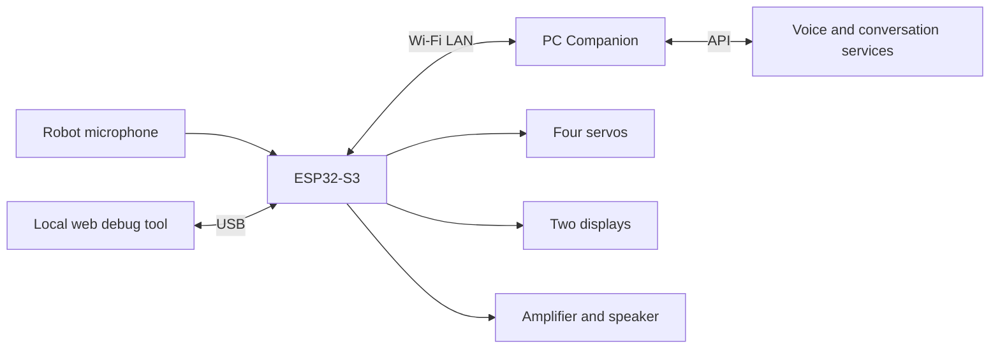

## Materials and cost

| Category | Per-robot estimate |
| --- | ---: |
| PCB components, including ESP32 but excluding bare board | CNY 23.74 |
| Purchased parts, including bare board and printed parts | CNY 124.24 |
| Assembly screws, allocated by actual consumption | CNY 4.42 |
| **Total** | **CNY 152.40** |

The workbook distinguishes purchase evidence, author-provided prices and estimates. This is a materials budget, not a kit selling price. Update prices using your own orders. ESP32 is already included in PCB components; do not count it twice. Buying full screw packs can cost more than the allocated per-robot amount.

| Main part | Specification |
| --- | --- |
| Servos | 4 × MG90S metal-gear servos |
| Displays | 2 × ST7735, 1.8-inch, 8-pin SPI |
| Battery | BOM specifies a protected 1S2P, 3.7 V, 6600 mAh 18650 battery pack |
| Microphone / amplifier | INMP441 / MAX98357A I2S modules |
| Speaker | 3 W, 8 Ω in the BOM |
| Mechanical items | Printed parts, battery tray, ballast, rear-cover mechanical switch, wires and terminals |

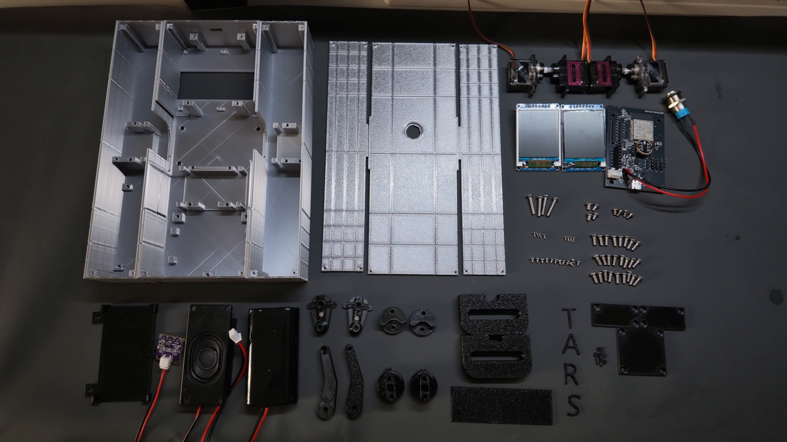

**C7 purchasing correction:** the author selected manufacturer part **CL05A105KA5NQNC**: **1 µF, 25 V, X5R, 0402**, LCSC **C52923**. If the source drawing still shows `100nF`, follow the manufacturer part and corrected BOM. [Manufacturer specification](https://datasheet.octopart.com/CL05A105KA5NQNC-Samsung-Electro-Mechanics-datasheet-110226201.pdf)

## Printing

Get the `TARS_Current_Structure` source and `TARS_Print_Current` printing materials on [MakerWorld](https://makerworld.com.cn/zh/models/3251650-ke-dong-ke-yu-yin-jiao-hu-de-tarsxing-ji-chuan-yue). Other platforms link there without redistributing model files.

The current three plates contain 37 objects: 3 shell pieces, 3 rear covers and 31 internal/decorative pieces. The existing profile uses a P2S, a 0.4 mm nozzle and 0.2 mm layers, with silver silk PLA for shells/covers and black PETG for internal structures. Use the current MakerWorld project for per-object supports and settings; review slicing when changing printer or material.

## Two critical assembly sequences

> [!IMPORTANT]
> **Solder Dupont wires to the display before mounting it.** Access becomes restricted after installation.
>
> **Before mounting the PCB, insert the mechanical button from the back of the rear cover, tighten its nut, then solder its wires to the PCB interface.**

The corresponding steps below repeat these instructions. GitHub uses prominent callout blocks; OSHWHub uses bold red reminders.

## Fasteners

| Location | Specification | Quantity |
| --- | --- | ---: |
| Two displays | M2×4 self-tapping, flat-bottom head | 8, four per display |
| Three rear covers | M2×6 self-tapping, flat-bottom head | 12 |
| Central servo cover | M3×8 countersunk | 4 |
| Outer-leg servo covers | M3×8 countersunk | 6 |
| Front-shell slide rails | M3×10 countersunk | 4 |
| Lower outer-leg linkage joints | M3×10 countersunk | 2 |
| Disc-to-shaft joints | M3×16 countersunk, author confirmed | 4 |
| Speaker | M3×5; flat-bottom head in assembly list | 4 |
| PCB | M3×6 socket head | 4 |
| Battery tray | M3×6 socket head | 3 |

The table totals 51 screws; additionally retain the screws supplied with the servos. Display screws were corrected from M2×2 to **M2×4**. Servo covers are approximately 2.5 mm thick. Lower linkage screws pass through approximately 5.7 mm of linkage and engage approximately 4.3 mm into the connecting part. M3×5 speaker screws are confirmed; check head clearance because the model reserves space for a socket head.

## Assembly

### 1. Move servos to their mechanical zero

Before installing servo arms and linkages, use the USB web tool to position each servo. Reference center is not automatically the mechanical zero of the assembled mechanism. Confirm the actual alignment first. A blank controller needs calibration-capable firmware before this step.

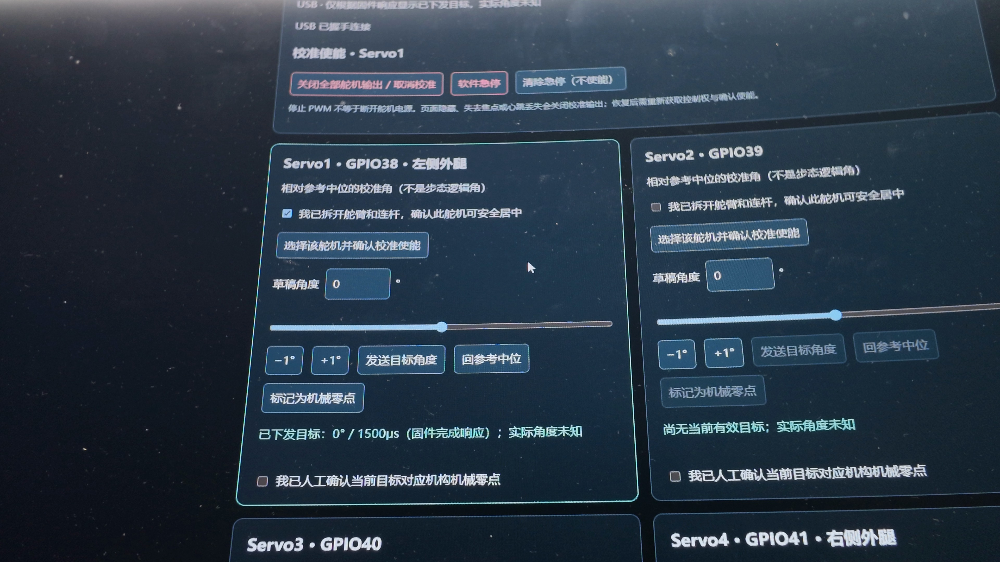

### 2. Distinguish the middle-leg and outer-leg connectors

The middle pair and outer left/right legs use different connectors. Blue parts in the first model image are for the middle legs; those in the second are for the outer legs. Face each connecting piece toward its servo and fasten it using the M3 screw supplied with the servo.

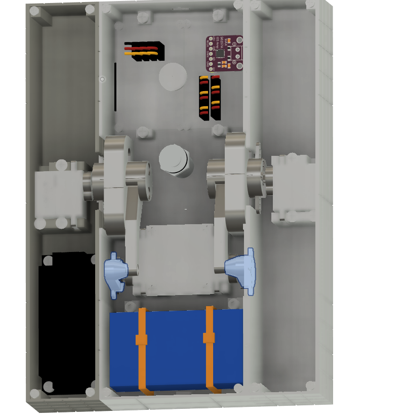

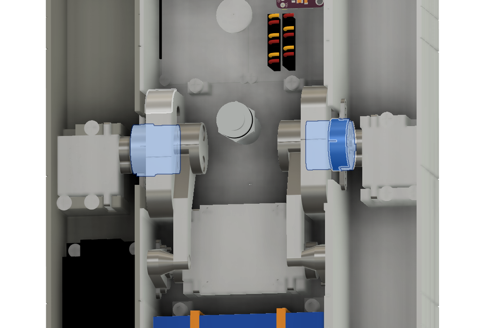

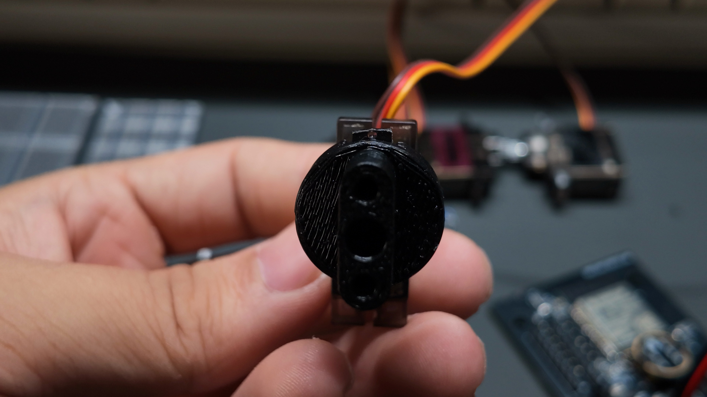

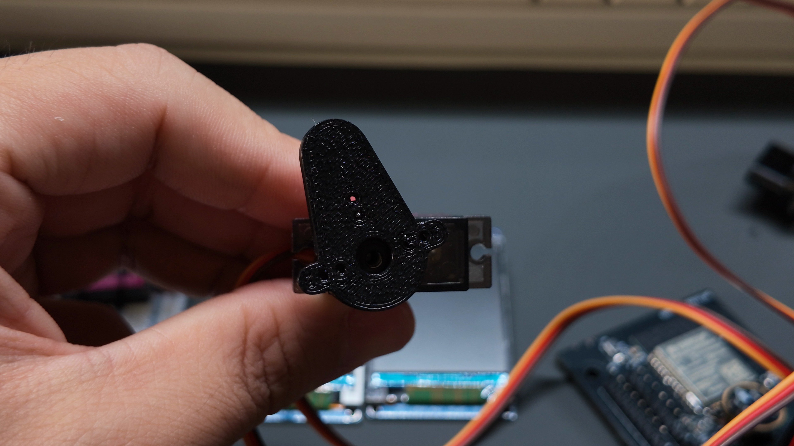

### 3. Solder display wires before mounting

> [!IMPORTANT]
> Solder Dupont wires to the rear display pads before mounting.

Use four M2×4 self-tapping flat-bottom-head screws per display, eight total. Match power, ground and signal pads; each display has its own chip-select connection.

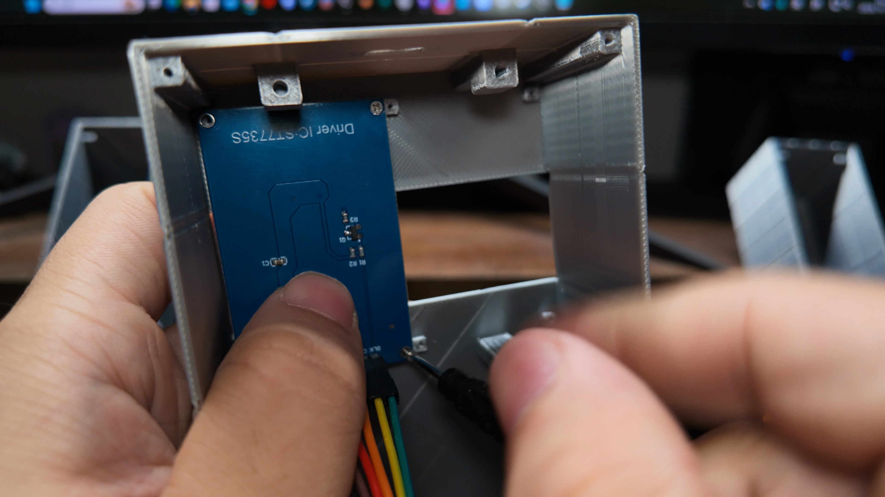

### 4. Complete the linkage and mount it in the central shell

Assemble the servos, vertically moving parts and outer-leg connectors, then mount the assembly in the central shell. Use M3×8 for servo covers, M3×10 for rails/lower linkage joints and M3×16 for disc-to-shaft joints, following the quantities and head types above.

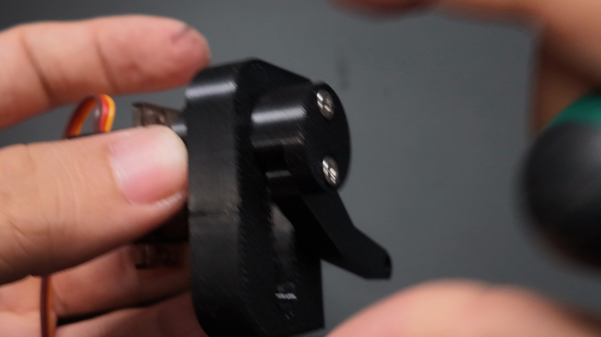

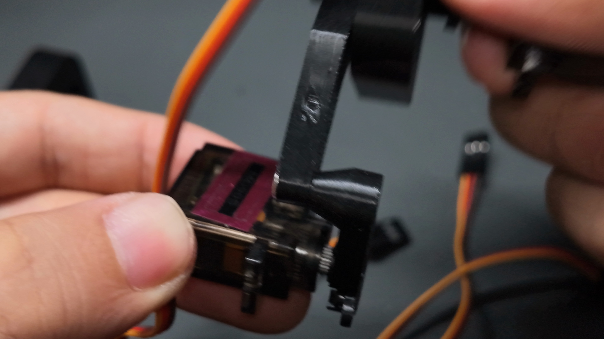

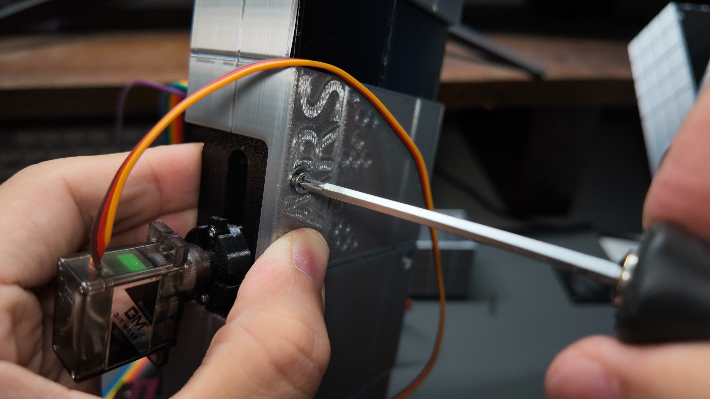

### 5. Install the rear-cover button before the PCB

> [!IMPORTANT]
> Insert the mechanical button from the back of the rear cover → tighten its nut → solder to the PCB interface → then mount the PCB.

Use switch interface H5 and leave enough wire for opening and closing the cover. This switch is separate from the board BOOT/RESET buttons.

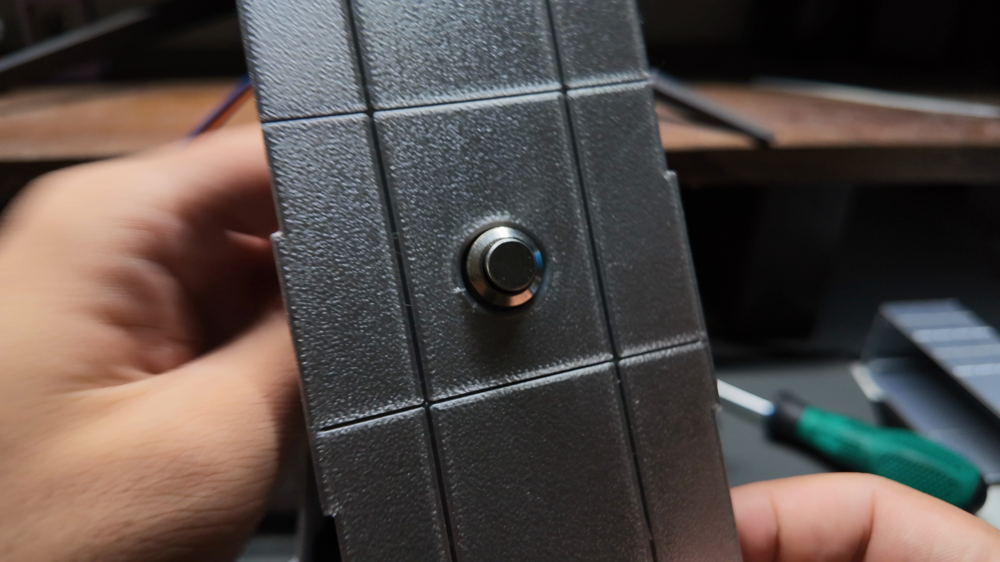

### 6. Mount the PCB

Align the PCB with the central-shell posts and secure it with four M3×6 socket-head screws. Keep switch/display wires out from under the board and mounting posts.

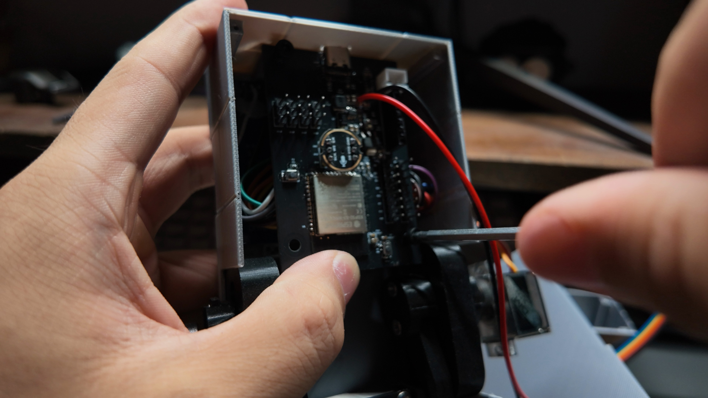

### 7. Connect the wiring harness

Connect the displays, servos, microphone, audio module and switch according to the schematic. Follow connector labels for power, ground and signals; photographed wire colors are not a universal pinout. Route wires clear of moving linkages and rails.

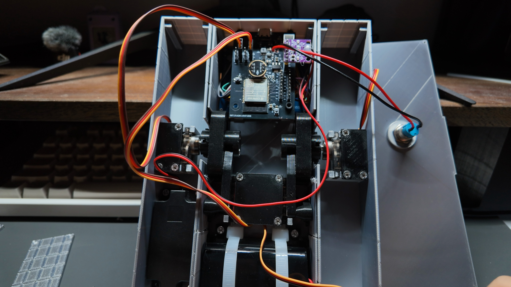

### 8. Install the battery

Install the battery and tray using three M3×6 socket-head screws for the tray. Check CN1 polarity. The photo shows layout; use the current MakerWorld model for the latest tray details.

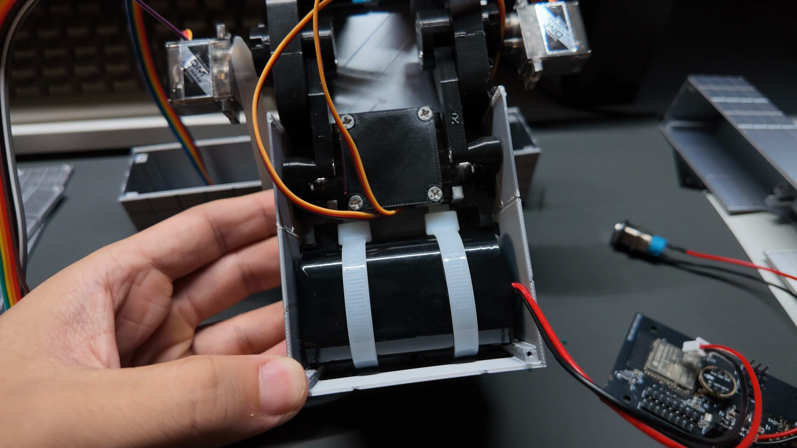

### 9. Install the speaker

Secure the speaker using four M3×5 screws and connect it to the amplifier output. Check screw-head clearance; do not connect the speaker directly to GPIO pins.

### 10. Check wiring and close the rear covers

Check connections, moving-part clearance and switch/wire space before closing. Use twelve M2×6 self-tapping flat-bottom-head screws across the three covers.

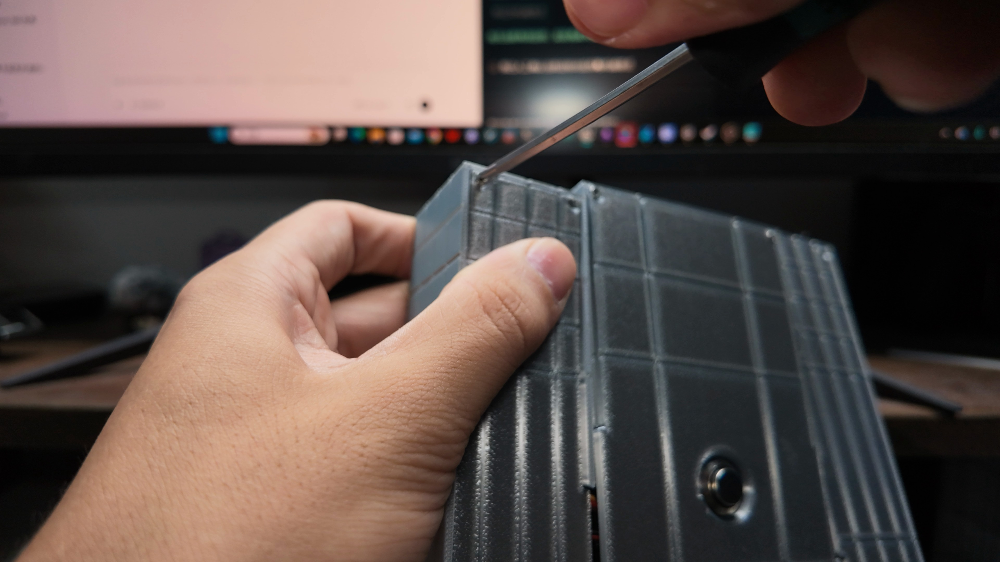

### 11. Flash and perform initial checks

Use the final author-confirmed package and instructions. For ESP32-S3 / 16 MB Flash, DIO / 80 MHz: bootloader at 0x0, partition table at 0x8000 and application at 0x10000. Existing devices with the same layout normally update only the application and retain NVS. Check displays, USB and mechanical zero before individual motion tests. See the AI setup guide for PC certificate requirements.

## Wiring reference

| Interface | Mapping |
| --- | --- |
| Servos | Servo1→GPIO38, Servo2→GPIO39, Servo3→GPIO40, Servo4→GPIO41; follow signal/5V/GND labels |
| Displays H1/H4 | BLK, CS, DC, RST, SDA, SCL, VCC, GND; verify each display's chip select |
| Microphone H2/H3 | MIC_DIN, MIC_SCK, MIC_WS, MIC_L/R and power/ground; follow the schematic |
| Audio output U1 | Connect the audio module; the speaker connects to its output |
| Battery CN1 | VBATT/GND; verify polarity |
| Rear switch H5 | Between VBATT and VBAT_5V |

Disconnect power before wiring or soldering. Use the hardware project for detailed nets and pads, with the C7 purchasing correction above.

## USB debugging

1. Extract the standalone servo debug package and install Python 3.11 or later.
2. Run `安装依赖.cmd` to install dependencies.
3. Connect the robot over USB and stop other debug/voice processes using the device.
4. Run `Start-Gait-Debug.cmd` for gait/action debugging; connect, confirm and enable in the page.
5. Use `Start-Servo-Debug.cmd` for single-servo calibration. Run one tool at a time. If the browser does not open automatically, copy the complete local URL printed in the terminal.

`--mock` displays a simulated device without hardware; it is not a hardware validation result. Stop and inspect calibration/assembly if the mechanism jams instead of repeatedly forcing motion.

## PC AI, API and Doubao voice cloning

The [PC configuration guide](docs/AI_SETUP.en.md) covers dependencies, LAN pairing, TLS certificates, API keys, voice training, Speaker IDs and troubleshooting. Installing board firmware and the USB debug package does not install a PC AI Companion.

Keep API keys, Wi-Fi passwords, pairing tokens, TLS private keys, personal recordings, conversation databases and runtime logs on your own PC. Do not publish them. Use a voice you are authorized to use. The PC service must keep running; closing the web page does not remove that requirement.

## Troubleshooting

| Symptom | First checks |
| --- | --- |
| Wrong servo direction or standing pose | Mechanical zero, middle/outer connector selection, channel mapping and orientation |
| USB page cannot find the robot | Data-capable cable, occupied port and compatible firmware; stop other services |
| Blank display | Power, solder joints, SPI and separate CS connections |
| USB works but voice does not | Running Companion, LAN configuration, token and matching TLS certificate/firmware |
| Cloud authentication or voice error | API project, enabled services, voice permissions and interface compatibility |
| BOM differs from an old drawing | Use the C7 manufacturer part: 1µF/C52923; include hardware date in further reports |

## License and feedback

Original hardware, mechanical models, firmware source, PC software and documentation use **CC BY-NC-SA 4.0**. **Commercial use requires separate permission from the author.** Preserve attribution and comply with ShareAlike requirements. Third-party components, fonts and resources retain their original rights; see [third-party notices](THIRD_PARTY_NOTICES.md).

For issues, provide the hardware date, firmware/software versions, printing profile, assembly step and reproducible behavior. Do not include actual credentials, pairing files or personal logs. Use repository Issues or the author's OSHWHub page.

TARS and *Interstellar* inspired this personal project; it is not affiliated with the film's rights holders.
