# 可动可语音交互的 TARS 星际穿越机器人

**中文** | [English](README.en.md)

一台受《星际穿越》TARS 形象启发的个人 DIY 机器人：四路舵机驱动结构运动，双屏显示表情和状态，通过电脑端 Companion 接入语音控制与云端对话。

**预计单台物料成本：¥152.40，包含部分暂估单价。** 含 PCB 电子元件、裸板、打印件、舵机、屏幕、电池、音频模块、线材与装配螺钉；不含运费、人工、焊接耗材、包装、损耗、税费及整包采购的额外金额。电脑与云端服务不在物料预算内。

[▶ Bilibili：完整制作与演示视频](https://www.bilibili.com/video/BV1uUW36kEMT/)

[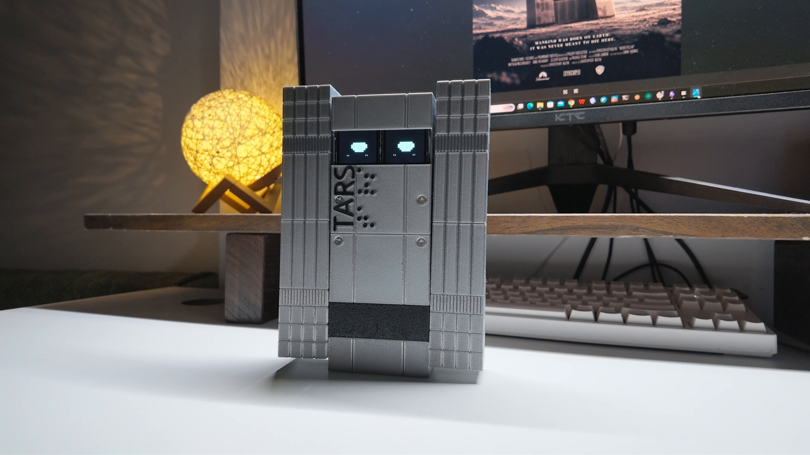](https://www.bilibili.com/video/BV1uUW36kEMT/)

视频仅通过 Bilibili 链接展示，本仓库不分发视频文件。

## 资料入口

| 内容 | 下载与说明 |
| --- | --- |
| 机械结构和打印工程 | [MakerWorld](https://makerworld.com.cn/zh/models/3251650-ke-dong-ke-yu-yin-jiao-hu-de-tarsxing-ji-chuan-yue)：结构源文件及三盘打印工程；模型只在这里发布 |
| 嘉立创制作页面 | [硬件、装配图文及发布附件](https://oshwhub.com/wenzeng1/project_hgrrprlm) |
| PCB 源工程 | [TARS_PCB_2026-11-13.epro2](hardware/TARS_PCB_2026-11-13.epro2)，嘉立创 EDA 专业版 |
| 整机 BOM 与成本 | [Excel 工作簿](hardware/Project_TARS_V1_BOM_2026-11-13.xlsx)，含板载器件、外购件、螺钉和价格依据 |
| 电脑端 AI 配置 | [Companion、API 与豆包音色克隆说明](docs/AI_SETUP.zh-CN.md) |
| 完整软件安装包 | [TARS-0.18.3-public.zip](https://github.com/doubleZ-dev/project-tars-software/releases/download/v0.18.3-public/TARS-0.18.3-public.zip) · [发布记录](https://github.com/doubleZ-dev/project-tars-software/releases/tag/v0.18.3-public)：固件、对应源码、日常语音 Companion、USB 调试和安装说明；替代旧两个零散包 |
| 许可 | [CC BY-NC-SA 4.0](LICENSE.txt)：原创资料禁止未经授权的商业使用，商用请联系作者 |

## 当前发布状态与版本边界

- 最新公开软件为 **0.18.3-public**。下载上方原始完整 ZIP，先读 `AI_INSTALL.txt`；其中 `firmware-source/` 与 `companion/` 是本版本配套源码。仓库旧 `0.18.0-director` 源码仅作历史参考，不是本版安装入口。
- 包含 ESP32-S3 固件、对应 ESP-IDF 源码、日常语音服务、舵机调试页面、配置模板与安装/烧录工具；**不含拍摄用 AI 导演台**。
- Windows 10/11 x64、Python 3.13 x64；固件面向 TARS PCB V1 / ESP32-S3 N16R8。首次安装联网下载依赖和约 155 MB 的本地识别模型。
- 每位用户在自己的电脑生成证书和随机配对凭据，通过 USB 写入设备；无需作者原机证书，也无需为首次配对重新编译固件。
- **提供者报告**已通过 ESP-IDF 5.5.3 编译、精简源码独立重编译、干净 Python 环境及本地/模拟检查，详见包内 `VALIDATION.txt`。**0.18.3 完整实机与用户云端对话验收尚未完成**；本次发布的文件/哈希检查不等于实机通过。
- 旧版原机烧录及当前三盘结构打印组装成功的反馈，不等于新版 0.18.3 实机验收。硬件资料采用作者的 2026-11-13 工程。

## 功能与运行方式

| 模块 | 功能 |
| --- | --- |
| 运动 | 4 个 MG90S 舵机，前进、左右转向及预设动作；机械零点、阶段角度和时间可调 |
| 显示 | 两块 ST7735 屏幕，显示表情、状态及对话信息 |
| 语音 | 机器人采音和播放，电脑处理服务连接；运动指令与云端对话按所用 Companion 版本运行 |
| 调试 | USB 连接、本机网页操作，单舵机校准和动作/步态调试分开启动 |
| 主控 | ESP32-S3-WROOM-1-N16R8，16 MB Flash、8 MB PSRAM |

机器人负责执行运动、显示和音频；电脑 Companion 是持续运行的服务桥梁，完整语音交互依赖电脑和相应云端服务，并不是 ESP32 在本地运行大语言模型。

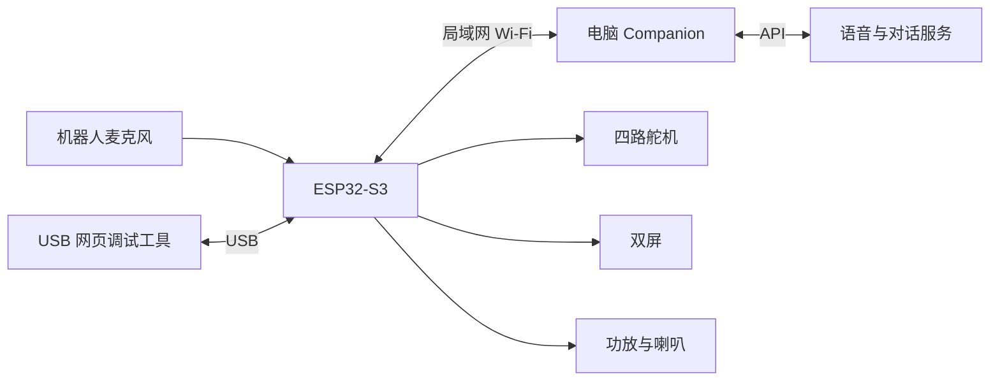

## 物料与成本

| 类别 | 单台预算 |
| --- | ---: |
| PCB 电子器件（含 ESP32，不含裸板） | ¥23.74 |
| 整机外购件（含裸板和打印件） | ¥124.24 |
| 装配螺钉，按实际消耗分摊 | ¥4.42 |
| **合计** | **¥152.40** |

工作簿区分订单截图实付价、作者提供价格和暂估价格。合计是物料预算，不是套件售价；请按自己的采购订单更新单价。ESP32 已计入 PCB 电子器件，不能重复算入外购件。螺钉按单机消耗计，整包采购费用通常不同。

| 主要部件 | 配置 |
| --- | --- |
| 舵机 | MG90S 金属齿轮，4 个 |
| 屏幕 | ST7735，1.8 英寸、8P SPI，2 块 |
| 电池 | 按整机 BOM：带保护板的 1S2P / 3.7 V / 6600 mAh 18650 电池包 |
| 麦克风 / 功放 | INMP441 / MAX98357A，I2S 模块 |
| 喇叭 | BOM 标注 3 W、8 Ω |
| 机械与配件 | 打印件、电池托盘、配重、后盖机械开关、导线及端子 |

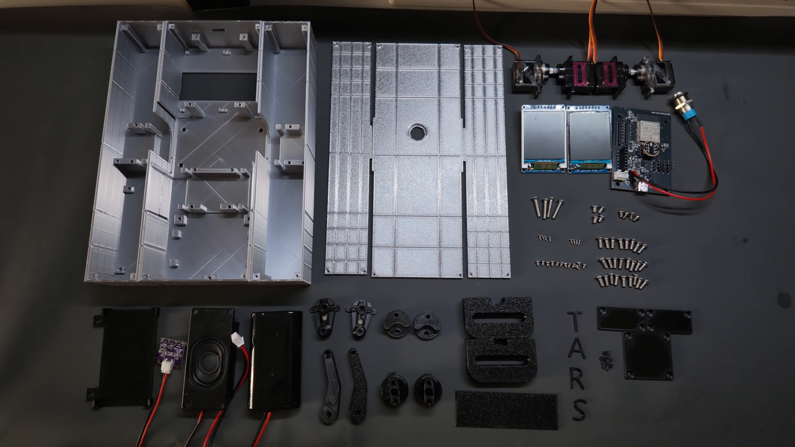

**C7 采购修正：** 按作者确认的厂家料号 **CL05A105KA5NQNC**，即 **1 µF、25 V、X5R、0402**，立创编号 **C52923**。工程若仍显示旧 `100nF` 标注，以厂家料号和本次 BOM 修正为准。[厂家规格书](https://datasheet.octopart.com/CL05A105KA5NQNC-Samsung-Electro-Mechanics-datasheet-110226201.pdf)

## 打印

在 [MakerWorld](https://makerworld.com.cn/zh/models/3251650-ke-dong-ke-yu-yin-jiao-hu-de-tarsxing-ji-chuan-yue) 获取 `TARS_Current_Structure` 结构源文件及 `TARS_Print_Current` 对应打印资料。其他平台只保留此链接，不复制模型附件。

当前三盘共 37 个对象：外壳 3 件、后盖 3 件、内部结构与装饰件 31 件。现有配置为 P2S、0.4 mm 喷嘴、0.2 mm 层高，银色丝绸 PLA 用于外壳/后盖、黑色 PETG 用于内部结构。支撑和逐对象设置以当前 MakerWorld 打印工程为准；换打印机或材料时重新检查切片。

## 装配前最重要的顺序

> [!IMPORTANT]
> **屏幕先焊杜邦线，再安装固定。** 装好后再焊，操作空间会受限。
>
> **PCB 安装前先处理后盖机械按键：从后盖背面装入 → 拧紧螺母 → 再焊接到 PCB 对应接口。**

这些是装配顺序要求，下面对应步骤再次标出。GitHub 用醒目提示块呈现；嘉立创页面使用红色加粗提醒。

## 螺钉清单

| 用途 | 规格 | 数量 |
| --- | --- | ---: |
| 两块屏幕 | M2×4 自攻，平底头 | 8（每块 4） |
| 三块后盖 | M2×6 自攻，平底头 | 12 |
| 中央舵机盖 | M3×8 沉头 | 4 |
| 左右腿舵机盖 | M3×8 沉头 | 6 |
| 正面壳体固定滑轨 | M3×10 沉头 | 4 |
| 左右连杆下端 | M3×10 沉头 | 2 |
| 圆盘连接圆轴 | M3×16 沉头，作者确认 | 4 |
| 喇叭 | M3×5，沿用平底头装配清单 | 4 |
| PCB | M3×6 杯头 | 4 |
| 电池托盘 | M3×6 杯头 | 3 |

合计 51 颗，另备舵机自带固定螺钉。屏幕规格已由 M2×2 更正为 **M2×4**。舵机盖厚约 2.5 mm；左右连杆下端螺钉穿过连杆约 5.7 mm，进入连接件约 4.3 mm。喇叭 M3×5 规格已确认，模型按杯头预留，安装时检查头部空间。

## 安装步骤

### 1. 让舵机到机械零点

在安装舵臂与连杆前，先通过 USB 网页调试工具逐只归零。参考中位与机构真正的机械零点不是同一概念；按实际机构位置确认后再装配。空白控制器需先烧录支持校准的固件。

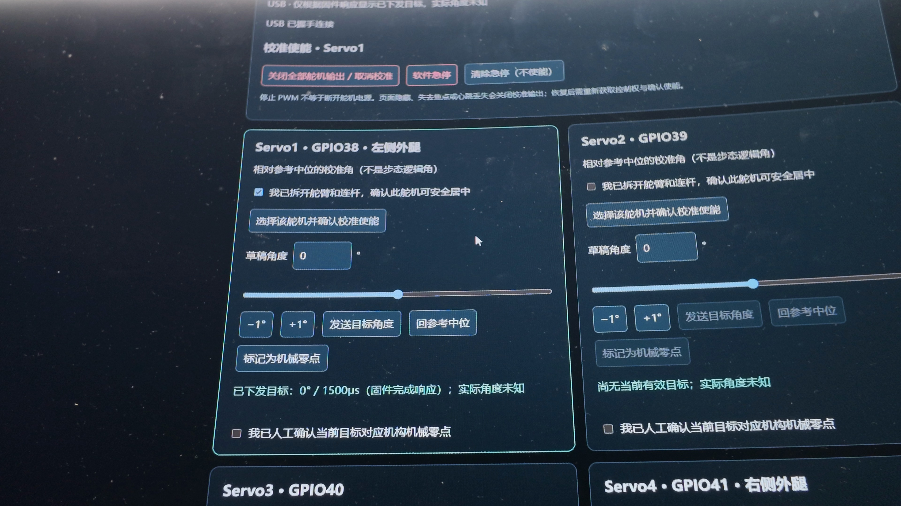

### 2. 区分中间腿和左右腿连接件

中间两条腿和左右两条腿使用不同连接件，不能混用。第一张模型图的蓝色零件用于中间两条腿，第二张用于左右两条腿。连接件朝向舵机，用舵机自带 M3 螺钉固定。

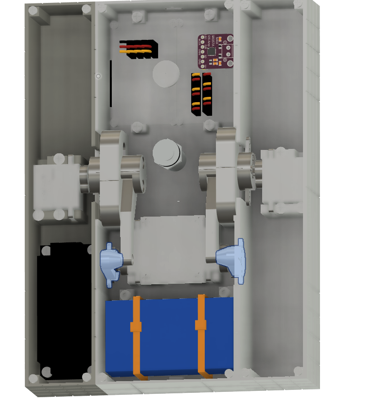

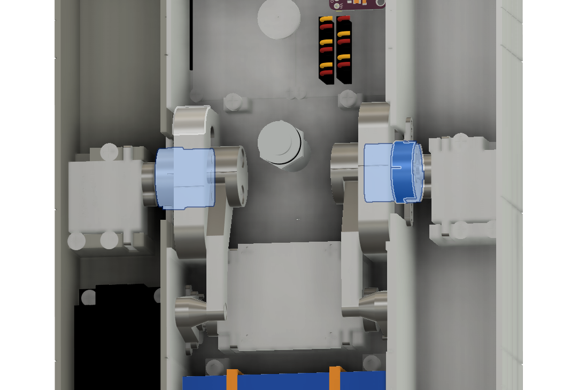

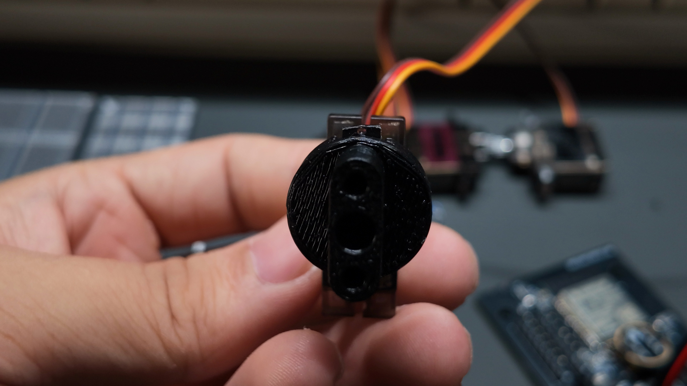

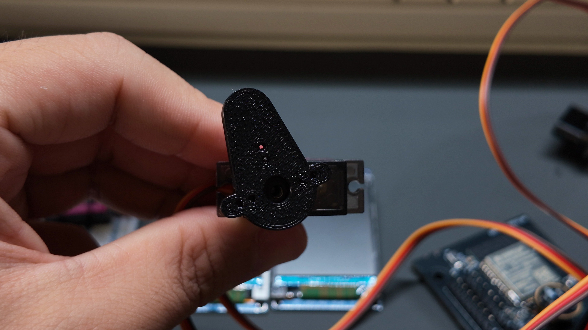

### 3. 先焊线，再安装屏幕

> [!IMPORTANT]
> 先把杜邦线焊到屏幕背面接线孔，再安装固定。

使用 M2×4 自攻平底头螺钉，每块 4 颗，两块共 8 颗。按焊盘标识核对电源、地与信号，两块屏幕分别对应各自片选。

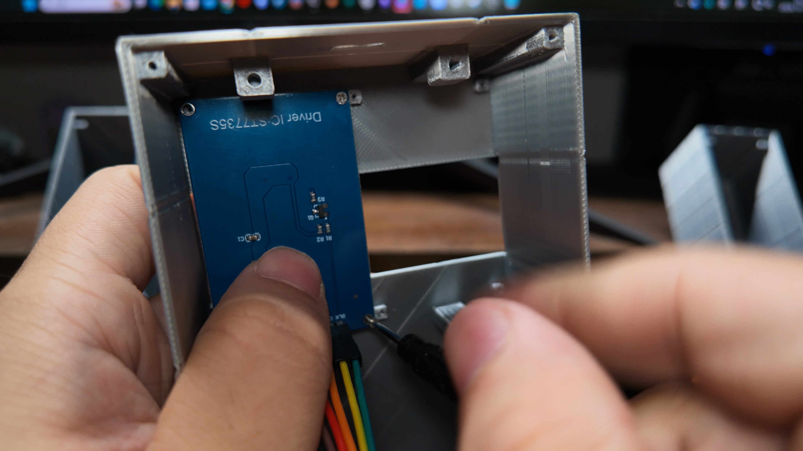

### 4. 补齐连杆并固定中央壳体

将舵机、上下运动的结构件和左右腿连接件装到一起，再固定到中央壳体。舵机盖 M3×8，滑轨与左右连杆下端 M3×10，圆盘连接圆轴 M3×16，均按上表数量与头型选用。

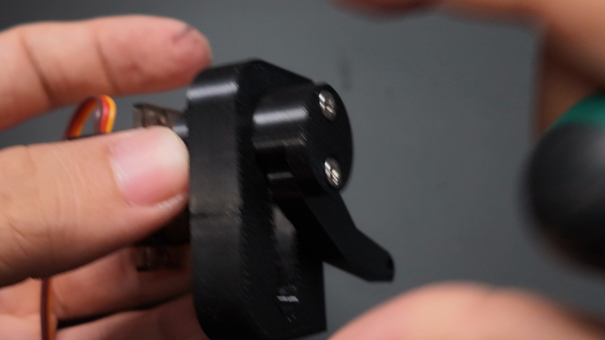

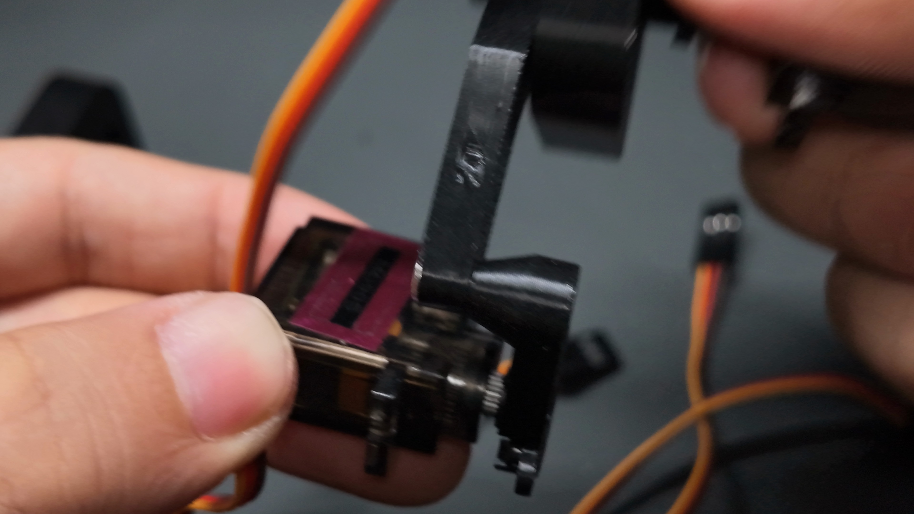

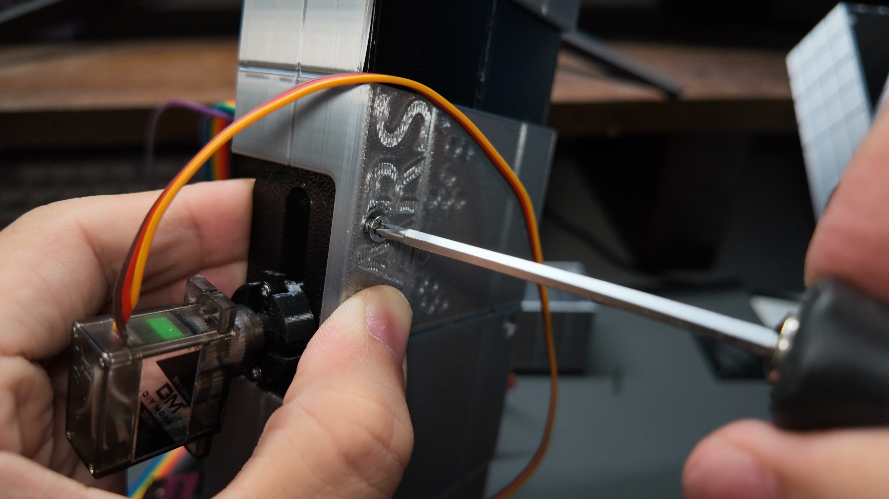

### 5. PCB 前先装后盖机械按键

> [!IMPORTANT]
> 从后盖背面装入机械按键 → 拧紧螺母 → 再焊接到 PCB 对应接口，完成后才安装 PCB。

对应开关接口 H5，留出后盖打开与合盖所需线长。该开关不同于板上的 BOOT/RESET。

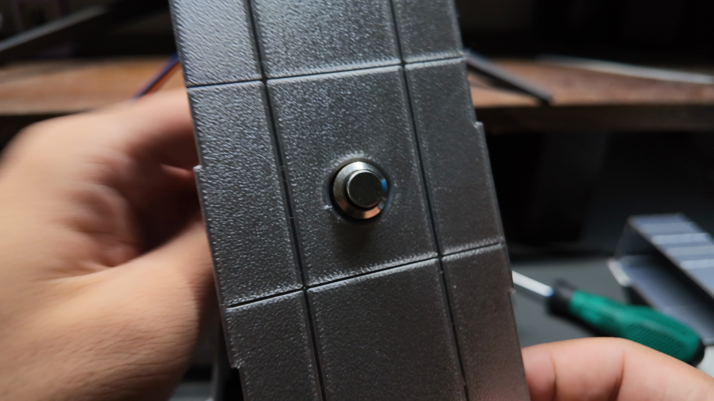

### 6. 安装 PCB

将 PCB 对准中央壳体固定柱，用 4 颗 M3×6 杯头螺钉固定。不要把开关线或屏幕线压在板底、固定柱之间。

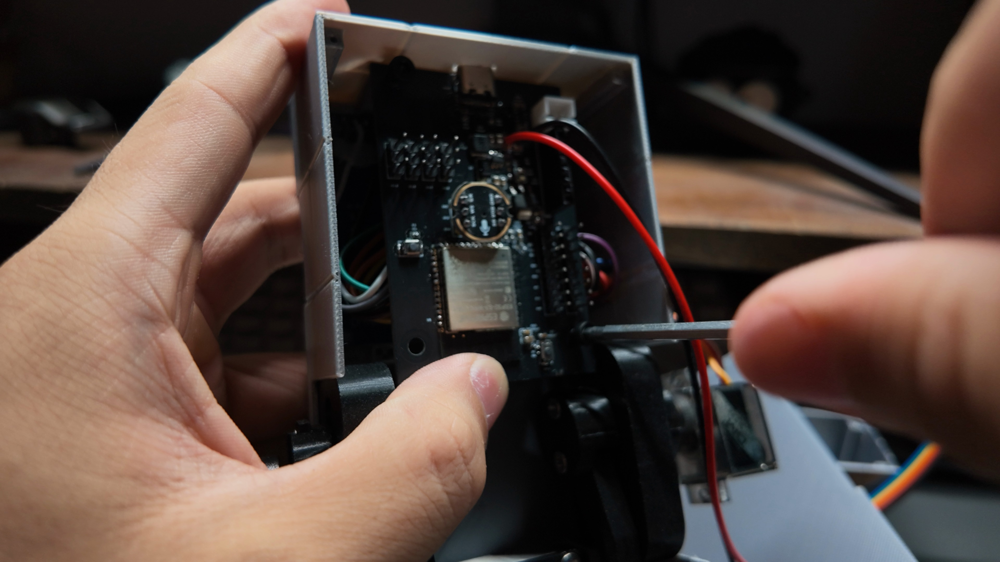

### 7. 连接线束

按原理图逐一连接屏幕、舵机、麦克风、音频模块和开关。按接口标识核对电源、地与信号；线色只作实拍参考。把线束整理到不妨碍连杆和滑轨的位置。

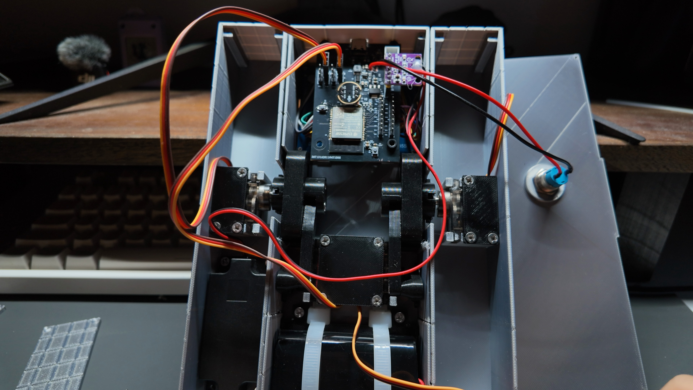

### 8. 安装电池

安装电池及托盘，托盘使用 3 颗 M3×6 杯头螺钉固定，核对 CN1 正负极。实拍用于布局参考，当前托盘细节以 MakerWorld 模型为准。

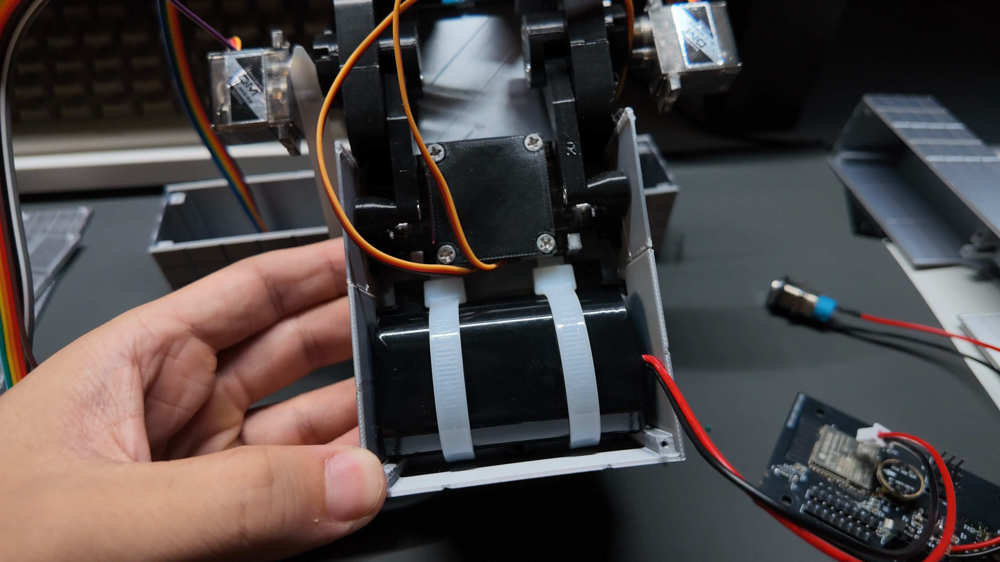

### 9. 安装喇叭

用 4 颗 M3×5 螺钉固定喇叭，接到音频功放模块输出端。核对螺钉头部空间，不把扬声器直接接到 GPIO。

### 10. 检查布线并盖后盖

确认接线牢固，线束不夹入机构，按键与线缆不影响合盖。三块后盖共用 12 颗 M2×6 自攻平底头螺钉。

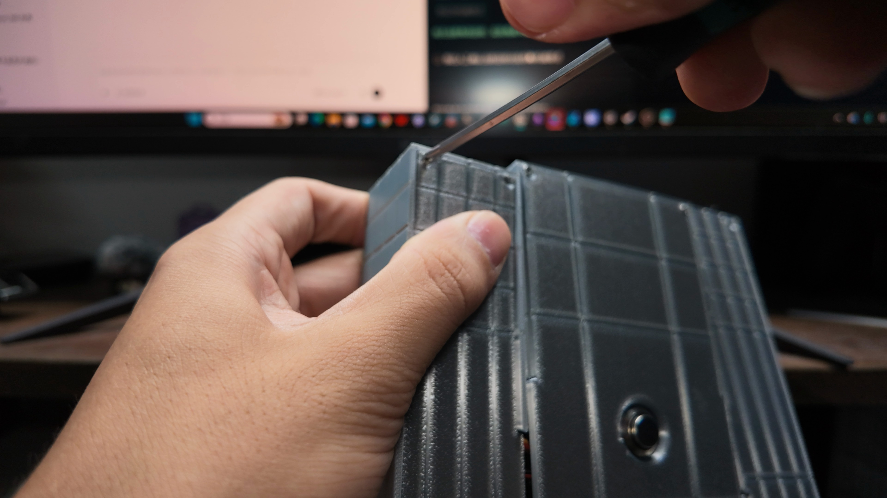

### 11. 烧录与首次检查

以作者最后确认的固件包和烧录说明为准。ESP32-S3 / 16MB Flash，DIO / 80MHz：bootloader 0x0，分区表 0x8000，应用 0x10000。已有同分区设备通常只更新应用并保留 NVS。确认显示、USB 连接及机械零点，再逐项测试动作。0.18.3 首次证书通过 USB 配置，详见 AI 配置说明。优先使用完整包内 `tools/flash.py` 校验、确认设备身份并烧录。

## 接线速查

| 接口 | 对应关系 |
| --- | --- |
| 舵机 | Servo1→GPIO38，Servo2→GPIO39，Servo3→GPIO40，Servo4→GPIO41；按信号/5V/GND 标记连接 |
| 屏幕 H1/H4 | BLK、CS、DC、RST、SDA、SCL、VCC、GND，分别核对两路片选 |
| 麦克风 H2/H3 | MIC_DIN、MIC_SCK、MIC_WS、MIC_L/R 与供电/地，按工程实际接口连接 |
| 音频输出 U1 | 接音频输出模块，扬声器接模块输出端 |
| 电池 CN1 | VBATT/GND，核对正负极 |
| 后盖开关 H5 | 位于 VBATT 与 VBAT_5V 之间 |

接线与焊接前断电。详细网络与焊盘位置以工程为准；采购 C7 时采用上文更正。

## USB 调试工具

1. 解压 **0.18.3-public 完整包**，安装 Python 3.13 x64，运行包根目录 `Install.cmd`。
2. 停止语音服务，USB 连接机器人，一次只运行一个工具。
3. 运行 `companion/Start-Servo-Debug.cmd` 做单舵机归零；运行 `companion/Start-Gait-Debug.cmd` 做动作/步态调试。
4. 校准机械零点、朝向和可活动范围后，再按页面流程使能动作。

`--mock` 仅用于模拟页面检查，不能视为实机验收。遇到卡滞先停止并检查结构和安装。

## 电脑 AI、API 与豆包语音克隆

详细流程见 [电脑端配置说明](docs/AI_SETUP.zh-CN.md)，包括依赖、局域网配对、TLS 证书、API Key、音色训练、Speaker ID 与排查。当前完整包已包含电脑端 Companion，按说明安装依赖并填写自己的云端配置后使用。

API Key、Wi-Fi 密码、设备配对 token、TLS 私钥、私人录音、对话数据库和运行日志均应留在自己的电脑，不提交到 GitHub 或公开附件。使用自己有权使用的音色。电脑端服务需持续运行，关闭网页不等于可以关掉服务。

## 常见问题

| 现象 | 先检查 |
| --- | --- |
| 舵机方向或站姿不对 | 机械零点、左右/中间连接件、舵机通道和安装朝向 |
| USB 网页找不到设备 | USB 数据线、端口占用、匹配固件；先关其他服务 |
| 屏幕无显示 | 电源、焊线、SPI 和独立 CS 接线 |
| USB 调试正常但语音不通 | Companion 是否运行、局域网配置、配对 token、TLS 证书与固件是否匹配 |
| 云端鉴权或音色报错 | API Key 所属项目、服务开通状态、音色权限及接口兼容性 |
| BOM 与旧工程标值不一致 | C7 按厂家料号 1µF/C52923；其余疑问附工程日期反馈 |

## 许可与反馈

作者原创硬件、机械模型、固件源码、电脑端程序及文档统一采用 **CC BY-NC-SA 4.0**。**未经作者另行授权不得用于商业用途；商用需联系作者。** 署名并遵守相同方式共享要求。第三方组件、字体和其他资源保留其原有权利，详见 [第三方说明](THIRD_PARTY_NOTICES.md)。

问题反馈请提供硬件日期、固件/程序版本、打印配置、对应装配步骤和可复现现象。不要附真实密钥、配对配置或个人日志。可在本仓库提交 Issue，或通过嘉立创作者页面联系。

TARS 与《星际穿越》是项目灵感来源，本项目与电影版权方无关联。
