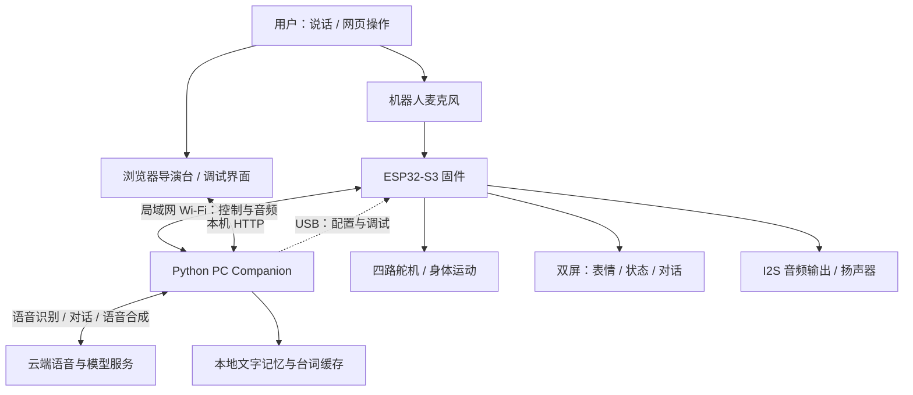

> 历史软件说明：版本和入口仅供参考。当前复刻入口、许可与硬件资料见仓库根目录 README。

# Project TARS · 我的独立设计机器人项目

**一台能够运动、听懂语音并作出语音回应，也能通过双屏表达状态和表情的实体机器人。**

Project TARS 是我（[@doubleZ-dev](https://github.com/doubleZ-dev)）独立设计、开发和整合的个人机器人项目，灵感来自《星际穿越》中的 TARS。从机械结构、电子硬件到运动控制、屏幕交互和语音系统，我希望把一个科幻角色逐步做成可以真实互动的机器人。

这个仓库先公开项目的**软件部分**：ESP32-S3 嵌入式固件、Python PC Companion、网页导演台、调试界面和自动化测试。机械模型、PCB 工程、制作素材及个人运行数据不在本次上传范围内，后续计划逐步完整开源。

“独立设计”指项目整体设计与集成由我完成；底层使用 ESP-IDF、FreeRTOS、LVGL、Opus 等第三方开源组件，语音服务使用外部模型，并非自行训练基础模型。

## 它能做什么

| 能力 | 实现内容 |
| --- | --- |
| 身体运动 | 四路舵机控制，前进、左转、右转，以及命名的情绪与社交动作；支持零点校准和步态调试 |
| 语音识别与回应 | 采集麦克风音频，经电脑端接入云端语音服务，识别用户说话并生成回应，再通过机器人扬声器播放 |
| 语音控制动作 | 将明确的呼叫及运动指令交给本地规则校验，再向设备发送命令；运动需要显式使能 |
| 双屏显示 | 两块 ST7735 显示屏，LVGL 绘制状态、表情和对话终端；支持像素表情 UI 与原版 UI 切换 |
| 表情系统 | 当前表情目录提供 34 项表情，支持指定保持时间、恢复自动表情和状态驱动 |
| 拍摄导演台 | 浏览器选择表情、身体动作、指定台词和等待时间，组成脚本；支持顺序编排、循环、导入导出和停止 |
| 指定台词播放 | 输入文字后合成语音、试听，再让机器人播放；重复台词可以使用本地缓存 |
| 本地文字记忆 | 日常语音模式包含 SQLite 文字记忆、明确事实保存及关键词查询/删除；个人数据库不上传 |
| 调试与保护 | 命令 ACK 与终态回执、控制租约、软件急停、取消、断线停止及单控制会话管理 |

这些能力并不意味着所有模式已经完成完整实机验收。运动、对话和显示分别有实现与历史验证；最新组合、长时间运行和日常模式仍需要继续测试。此项目不是自主导航机器人，当前没有声称实现视觉导航、平衡闭环或播放中可靠语音打断。

## 整体架构

机器人端负责实时执行，电脑端负责交互编排与服务接入，云端提供语音和对话模型能力。**当前完整语音体验需要电脑端 Companion 运行，机器人不是脱离电脑独立运行大模型。**



### 机器人固件

- 主控：ESP32-S3-WROOM-1-N16R8，16 MB Flash、8 MB PSRAM。
- 框架：ESP-IDF 5.5.3 / FreeRTOS；当前导出版本为 `0.18.0-director`。
- 运动：四路 MCPWM 舵机输出，动作关键帧与插值、校准和状态管理。
- 显示：SPI 双屏、LVGL 9.2.0、表情渲染和对话终端。
- 音频：I2S 麦克风与扬声器、网络音频传输及 Opus 编解码。
- 通信：JSON 控制协议、Wi-Fi 音频通道、WebSocket 音频集成，以及 USB 配置/调试。

### PC Companion

- Python 3.11+，负责连接设备、解释命令回执和管理会话。
- 提供导演台、舵机校准、步态调试及语音运行入口。
- 包含豆包实时语音与 Seeduplex 接入，也保留历史 ASR / LLM / TTS 适配器。
- 语音动作通过本轮识别文字和本地规则校验，模型不能任意绕过设备控制流程。
- API Key、配对信息、个人配置、记忆和音频缓存保存在本机。

## 仓库结构

```text
firmware/
├── tars_director_firmware/   # 当前整合固件
│   ├── main/                # 启动入口与项目配置
│   └── components/          # 运动、屏幕、音频、协议等项目组件
├── tars_companion/
│   ├── tars_companion/      # Python 核心逻辑和网页资源
│   ├── tests/               # 离线单元测试及浏览器检查脚本
│   ├── *.example.json       # 无凭据的配置示例
│   └── Start-*.cmd / *.ps1  # Windows 启动器
└── prepare_xiaozhi_tls.py   # 为本机生成 TLS 密钥和固件信任证书
licenses/                   # 保留的第三方许可
THIRD_PARTY_NOTICES.md       # 依赖与资源说明
```

本次选择最新整合固件，而非把重复的旧固件、实验目录、历史发布包全部上传。Companion 内较早的说明保留作历史参考，涉及旧版本与本机路径时，以当前根目录说明和实际代码为准。

## 开始使用

### 1. 安装电脑端

```powershell
git clone https://github.com/doubleZ-dev/TASK-TARS-Embodied-Robotics.git
cd TASK-TARS-Embodied-Robotics/firmware/tars_companion
python -m venv .venv
.\.venv\Scripts\python.exe -m pip install -e ".[daily,doubao,voice,gpt]"
```

Windows 启动器默认使用当前目录的 `.venv`。部分语音模式还需要下载本地唤醒/识别模型；模型文件未随仓库分发。Windows Opus 运行库及来源、校验值和许可证保留在 `tars_companion/native/`。

### 2. 先体验模拟导演台

```powershell
powershell -ExecutionPolicy Bypass -File .\Start-Tars-Director.ps1 -Mock
```

模拟模式用于查看界面和编排流程，不能作为机器人动作或真实语音效果的验收。真实运行需要匹配的机器人、网络配对和相关服务配置。

### 3. 配置真实设备与语音

- 将 `wifi-audio.example.json` 复制为 `wifi-audio.local.json`，填写自己的 Wi-Fi、电脑局域网地址及随机配对令牌；不要提交实际配置。
- 日常语音配置可从 `tars-seeduplex.example.json` 复制为 `tars-seeduplex.json`，根据自己的服务资源填写。
- 通过 `Setup-Tars-Director.cmd` 在本机配置语音服务。示例代码中的音色 ID 是原项目的设置，不保证其他账号可用，需要使用自己有权限的音色和服务资源。
- 启动 `Start-Tars-Director.cmd` 打开导演台。日常语音及历史入口详见 Companion 目录中的说明。

### 4. 构建固件

先安装并激活 ESP-IDF 5.5.3。配置本机网络资料后，在仓库根目录运行：

```powershell
firmware/tars_companion/.venv/Scripts/python.exe firmware/prepare_xiaozhi_tls.py
cd firmware/tars_director_firmware
idf.py set-target esp32s3
idf.py build
```

TLS 脚本将私钥保存在被忽略的本地 `data/tls/` 中，只将公钥证书写入固件组件。每个部署环境应生成自己的证书。未修改的 LVGL 与 ST7735 驱动由 ESP-IDF 组件管理器根据固定版本下载；构建缓存和旧的绝对路径锁文件未上传。

烧录前需要核对自己的 PCB 引脚、Flash 分区与舵机参数。本仓库没有附带当前机器的配对配置、Flash 备份或一键覆盖设备的安装包。

### 5. 运行离线测试

在 `firmware/tars_companion` 目录中：

```powershell
.\.venv\Scripts\python.exe -m unittest discover -s tests
```

测试覆盖协议、语音编排、导演台、校准与运动指令规则等；离线测试不等于硬件测试。本次上传的验证结果见 [导出验证记录](VALIDATION.md)。

## 当前状态与后续计划

- 已具备实体运动、语音交互和双屏显示能力；软件仍在持续迭代。
- 导演台支持无线表情切换、台词播放和脚本编排。
- 日常模式的真人跨次记忆、语音工具与真实动作组合，及长时间循环仍需进一步验收。
- 当前舵机没有角度反馈传感器，执行回执不能替代实际姿态测量。
- 后续计划完善安装与配置流程、持续测试，以及逐步开放硬件和机械设计。

## 开源与依赖

这是计划逐步完整开源的个人项目，目前先公开整理后的软件源码。**项目原创资料现采用 CC BY-NC-SA 4.0；未经授权禁止商用。**第三方组件继续遵循各自许可证，详见 [第三方说明](THIRD_PARTY_NOTICES.md)。

TARS 与《星际穿越》是项目灵感来源，本项目为个人制作，与电影版权方无关联。
